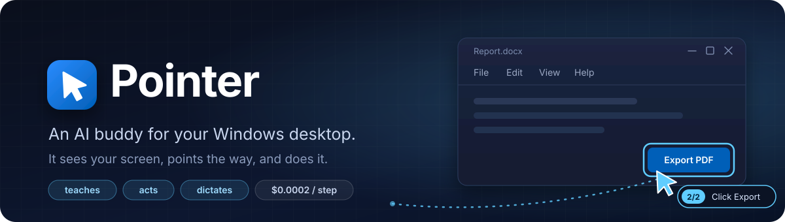
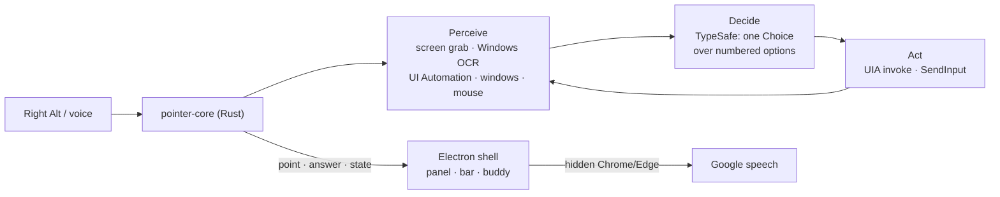

<p align="center">
  
</p>

<h1 align="center">Pointer</h1>

<p align="center">
  <b>An AI buddy that lives on your Windows desktop.</b><br>
  Press a key, say what you want. It sees your screen, points the way, and can do it for you.
</p>

<p align="center">
  <a href="LICENSE"></a>
  
  
  
  <a href="https://docs.typesafe.ai"></a>
</p>

<p align="center">
  <a href="#install">Install</a> ·
  <a href="#what-it-does">Features</a> ·
  <a href="#hotkeys">Hotkeys</a> ·
  <a href="#why-its-cheap-and-fast">Why it's cheap</a> ·
  <a href="#how-it-works">How it works</a> ·
  <a href="#build-from-source">Build</a>
</p>

---

```
 Right Alt  →  "how do I export this as PDF?"

   Pointer  →  "Use the File menu, then Export."
               ➜ the buddy glides to File      (step 1/2)
               ➜ then to Export as PDF          (step 2/2)
```

Pointer is one hotkey that knows what's on all your screens and what's under your mouse. Ask it something and it **teaches** you, pointing at
each thing as it talks. Give it a goal and it **does** it, clicking and typing for you. Hold a key
and it **types what you say** into whatever you're writing in.

Each decision costs about **$0.0002** and takes **under 0.6 s**, because Pointer never ships your
screenshot to a frontier model to plan a click.

## What it does

| | |
|---|---|
| 🗣️ **Ask, and it teaches** | "What is this?", "How do I turn on dark mode here?" It answers out loud, then walks you through it step by step while a cursor buddy points at each control. |
| 🤖 **Tell it, and it does it** | "Open YouTube and search for lo-fi." In **Act** mode it reads the screen, picks the next step, clicks and types until it's done. The buddy flies to each target first, so you always see where it's about to click. |
| ✍️ **Dictate anywhere** | Hold `Ctrl+Alt+D`, speak, let go. The words are typed into the field you're in: Word, Slack, a browser form, anything. |
| 🖱️ **Knows where you're pointing** | "This", "here" and "that" mean whatever is under your mouse. Questions read the monitor your mouse is on. |
| 🖥️ **Sees every screen** | It knows every window on every monitor, minimized or not, so it switches to what's already open instead of opening a second copy. |
| 🎙️ **Free voice, no key** | Uses Google's speech recognition through your own Chrome or Edge, so voice costs nothing. You can switch to Windows' built-in recognizer or OpenAI. |
| 👀 **Dry run first** | Pointer starts in Dry run: it decides and points, but never touches the mouse or keyboard. Switch to Act when you trust it. |
| 📼 **Every run is replayable** | Each step's screenshot, the options it was offered, and the probability it gave each one are saved. History shows them. |

## Install

1. **Build the installer.** Pointer isn't released yet, so [build it from source](#build-from-source):
   `npm run dist` writes `ui\dist\Pointer Setup 0.1.0.exe`.
   The installer isn't code-signed yet, so SmartScreen will ask: **More info → Run anyway**.
2. **Add your keys.** Pointer opens on Settings the first time.

   | key | needed for | where to get it |
   |---|---|---|
   | `TYPESAFE_API_KEY` | every decision (**required**) | [typesafe.ai](https://docs.typesafe.ai) |
   | `OPENAI_API_KEY` | spoken answers, teaching, typing free text | [platform.openai.com](https://platform.openai.com) |

   Keys are saved to `%LOCALAPPDATA%\pointer\.env` and never shown again, not even to you.
3. **Try it.** Hover over something, press `Right Alt`, and ask *"what is this?"*

Works on Windows 10 and 11, with Chrome or Edge for free voice (Edge ships with Windows).

## Hotkeys

| key | does |
|---|---|
| `Right Alt` | **The one key.** Opens the bar at your mouse and starts listening. Speak, or just start typing. |
| hold `Ctrl+Alt+Space` | Push to talk, no bar |
| hold `Ctrl+Alt+D` | Dictate into the field you're in |
| `Ctrl+Alt+G` | Bring up the Pointer window |
| `Ctrl+Alt+P` | Pause or resume a run |
| `Ctrl+Alt+X` | Stop a run. Slamming the mouse into the top-left corner of your main screen stops it too. |

Change any of them in **Settings → Hotkeys**: click **Change**, press the new combo, **Apply**.
Changes take effect immediately, and Pointer tells you if another app already owns a combo.

**The bar figures out what you meant.** You never pick a mode:

- *"Open my email"* is a **goal**, so Pointer runs it.
- *"What does this button do?"* is a **question**, so Pointer teaches.
- *"Stop"* is a **command**, so the run ends.

A typed line is classified the same way. Press `Tab` in the bar to dictate instead.

## Why it's cheap and fast

Most computer-use agents send a screenshot to a frontier model on every step and wait seconds for
a plan. But most steps don't need a plan. They need **one choice from a short list**, made fast,
with a confidence number you can trust.

That's exactly what [TypeSafe](https://docs.typesafe.ai) sells: a decision model that picks from up
to 255 options with a calibrated probability for each, in a few hundred milliseconds. Pointer reads
the screen itself, deterministically, and asks TypeSafe only *which* option.

Measured on the same screenshot and goal, one decision each:

| | Pointer (TypeSafe) | Frontier model + screenshot | |
|---|---|---|---|
| cost per decision | **$0.0002** | $0.032 to $0.08 | **155–390× cheaper** |
| cost of a 12-step task | **$0.003** | $0.40 to $0.90 | **130–300× cheaper** |
| decision latency | **0.13–0.6 s** | 5.2 s | **10–40× faster** |

The honest catch: a frontier model reasons over pixels for free. Here, every piece of that
reasoning has to be rebuilt as deterministic state: dates parsed into "in 27 days", controls read
from the accessibility tree, the window list, the mouse. That rebuilt state is most of this repo.

### Rust vs the Python original

Pointer's core was rewritten from Python to Rust to ship as one installer. Ten identical goals,
dry run, same screen, interleaved:

| per step (median) | Python | Rust |
|---|---|---|
| screen capture | 0.19 s | **0.03 s** (6× faster) |
| OCR | 0.16 s | **0.12 s** |
| accessibility walk | 0.6 s cap | 0.6 s cap, **~3× more controls found** |
| TypeSafe decision | 0.58 s | 0.56 s (network-bound) |
| **whole step** | **1.53 s** | **1.19 s** (22% faster) |

What the rewrite really bought is distribution: a 9 MB core and one installer, instead of
"install Python, install uv, open a terminal".

## How it works



**Every step:**

1. **Perceive.** Grab the display, read it with Windows OCR, and walk the window's UI Automation
   tree for real controls (buttons, links, fields). Merge the two into one numbered list. Add
   every open window on every monitor, the focused field, the browser URL, the date, and what's
   under the mouse.
2. **Decide.** One TypeSafe request with three or four questions: *what kind of action*, *which
   item*, *which website*, *which window*. The questions are separate so screen noise never blurs
   the choice of action.
3. **Act.** Press the control through UI Automation, so the click lands even if something
   covers it. Fall back to a real click. Type, scroll, switch windows, or launch an installed app.
   Nothing the model writes is ever used as a path or URL: it answers with a key, and code owns
   the address.
4. **Stop** on `done`, low confidence, two no-ops in a row, your abort, or the step limit. Then
   read the final screen and say what happened.

The writer model (OpenAI) is used only where free text is unavoidable: composing text to type,
proposing a URL for a site Pointer doesn't know, and answering or teaching from the screen.

### Sites and apps, learned from your machine

There's no hard-coded site list. Pointer builds a catalog from your browser's **bookmarks and
history**, around 500 sites here, and a list of installed apps from the Start Menu. A fast
deterministic ranker shortlists about 30 per goal, and the classifier picks one. A site it had to
ask the writer about is remembered, so it's a plain lookup next time.

Only `Bookmarks` and the `urls` table of `History` are ever read. Passwords, cookies and autofill
are never touched.

## Privacy and safety

- **It looks only when you ask.** The screen is read when you press a hotkey or start a run.
- **Your keys stay put.** They're stored in `%LOCALAPPDATA%\pointer\.env` and never displayed,
  logged or sent to the panel.
- **Dictation stays private.** Dictated words are typed and forgotten. The log records only
  "dictated N characters".
- **Voice goes to a speech service.** With the default engine, audio goes to Google's speech
  service (Microsoft's with Edge), exactly as when a website uses voice input in that browser.
  `CLICKER_STT=windows` uses Windows' built-in recognizer instead.
- **It won't read itself.** Pointer's own windows are excluded from what it reads, so it never
  clicks its own buttons.
- **It never types passwords.** Credential fields are refused. Use your password manager.
- **You can always stop it.** `Ctrl+Alt+X`, saying "stop", or the mouse in the top-left corner.

## Settings

Everything is in the Settings tab. These are the ones worth knowing:

| setting | default | does |
|---|---|---|
| `CLICKER_STT` | `auto` (chrome) | voice engine: `chrome` (free, Google), `windows`, `openai` |
| `CLICKER_STT_LANG` | `en-US` | speech language |
| `CLICKER_POINT_LEAD_MS` | `350` | how long the buddy points before an Act click (0 = no pause) |
| `CLICKER_BROWSER` | `Google Chrome` | the browser runs use |
| `CLICKER_EMAIL` | none | enables "type my email" |
| `CLICKER_CATALOG` | on | `0` offers only the pinned sites, ignoring your browser |
| `CLICKER_CATALOG_TITLES` | on | `0` sends bare domains, never page titles |
| `CLICKER_WRITER_MODEL` / `CLICKER_ANSWER_MODEL` | `gpt-4.1-mini` / `gpt-4.1` | writer and answer models |
| `POINTER_HOME` | `%LOCALAPPDATA%\pointer` | where `.env` and `runs\` live |

## Every run is saved

`runs\<timestamp>\` holds everything needed to see why a step went the way it did:

| file | what's in it |
|---|---|
| `run.log`, `run.json` | the goal, outcome, answer, every action, timings |
| `step-NNN.png` | the screen, with every option numbered and the chosen one in red |
| `step-NNN-payload.txt` | the exact state and options sent to TypeSafe |
| `step-NNN-answers.json` | every probability that came back |

The **History** tab replays them.

## Build from source

You need [Rust](https://rustup.rs) (MSVC toolchain) and [Node.js](https://nodejs.org) 20+.

```powershell
git clone https://github.com/Vatsa10/typesafe-computer-use-win
cd typesafe-computer-use-win

cd rust;  cargo build --release          # pointer-core.exe
cd ..\ui; npm install
npm start                                 # run against the debug core
npm run dist                              # installer in ui\dist\
```

For development, put a `.env` with your keys in the repo root. A checkout uses it in place of
`%LOCALAPPDATA%\pointer`.

```
rust/crates/
  platform/   Windows only: monitors, capture, OCR, UI Automation, input, hotkeys, speech, audio
  api/        TypeSafe and OpenAI clients
  core/       perception, decisions, actions, the run loop, teaching, catalogs
  app/        pointer-core.exe: the daemon, hotkeys and the IPC server
ui/src/
  main.js     the shell: windows, the command bar, the buddy, the speech bridge
  components/ the panel: run, history, settings, hotkey recorder
  stt/        the hidden-browser speech bridge
  protocol.md the line protocol between the shell and the core
```

The shell starts the core as a child process and they talk newline-delimited JSON over
stdin/stdout. There's no local port to firewall. See [`ui/src/protocol.md`](ui/src/protocol.md).

```powershell
cd rust; cargo test --workspace; cargo clippy --workspace --all-targets
```

The live tests are `#[ignore]`d. They read the real screen, call the real APIs, or use the
mic, and they never click.

## Known limits

- **What it can see.** It sees text (OCR) and the controls apps publish (UI Automation). An
  icon-only button in a game, a canvas or a terminal is invisible to both.
- **Admin windows.** An app running as administrator ignores input from a non-admin Pointer.
- **Using the PC during an Act run.** If you use the mouse and keyboard while it acts, you fight
  it for focus.
- **Teaching.** Teach steps point only at things Pointer actually found on screen. Otherwise the
  step is spoken without an arrow.
- **Signing.** The installer is unsigned for now.
- **The hidden speech window.** If Pointer is force-killed, the hidden speech window can linger
  until the next launch cleans it up.

## The Python original

`typesafe_computer_use_win/` is the original Python implementation. It's kept as the reference
every Rust component was checked against, and it still works:

```powershell
uv sync
uv run winclicker "open the Playground"         # dry run, one step
uv run winclicker "open the Playground" --act   # drive the machine
uv run winclicker-ui                            # the old panel
```

## Credits and license

The decision loop and design come from
[awlevin/typesafe-computer-use](https://github.com/awlevin/typesafe-computer-use) (macOS).
Pointer is the Windows port and desktop app built on it. [MIT](LICENSE), with both notices kept
as MIT requires.
