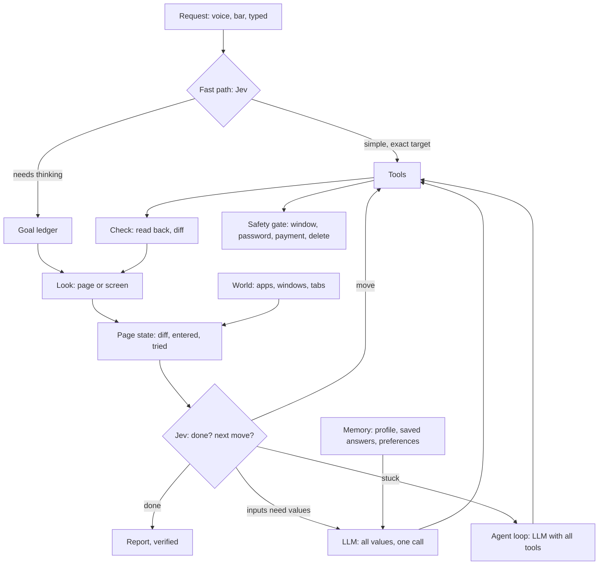

# Pointer harness architecture

**Status:** accepted 2026-11-05

**Goal:** Pointer sees the screen, scrolls to find what it needs, reads the questions, answers from
what it knows about the user, and finishes the job fast, on its own, on a page it has never seen.

## Requirements

Functional
- Works on any site or app from what is on screen. No site, form or button is named in code.
- Keeps state: the machine (world), the page (page state), the task (goal ledger), the user (memory).
- Plans, acts, checks each move, changes strategy when stuck, and reports truthfully.

Non-functional
- A simple command acts in under 1 s. A form page takes seconds, not minutes.
- Big-model calls per task are few and bounded; Jev is the per-step decider.
- No wrong action is worse than a slow one: a wrong submit costs more than a handoff.
- Safety holds at every autonomy setting.

## The rule for what goes where

| Question | Who answers | Why |
|---|---|---|
| What does this mean? Which option fits? Is it done? Did it work? | **Jev** | Typed judgment, about 0.4 s, calibrated |
| What should the values be? What is the plan? What now that this surprised us? | **LLM** | Reasoning and writing, about 2 s |
| Do it. Compare exact values. Track state. Enforce limits. | **Code** | Exact, free, instant |

**Test for any new code:** if it compares page text against a list of words to decide what something
*means*, it is wrong and belongs to Jev. Lists are allowed only for safety, where a false negative
must be impossible to talk around (see ADR-4).

## Shape

## Layers

1. **Perception:** one snapshot type for any surface, built from the accessibility tree, OCR and,
   when text is sparse, an image for Jev.
2. **State:** world, page state, goal ledger, memory. Observed facts carry a time and refresh when
   stale. What is inferred stays separate from what was observed.
3. **Decision:** the driver loop above. One Jev request per step answers both "done?" and "next?".
4. **Tools:** few and general. Every result says what happened and what to try next.
5. **Safety:** one gate every action passes through, independent of model and prompt.
6. **Skills:** short playbooks loaded only when a request matches. They guide; they never hold logic.
7. **Measurement:** the task set is the definition of better. No change lands that lowers it.

## Decisions

### ADR-1: One page driver, not per-task flows
Decision: a single look, decide, act, check loop for every goal on a page.
Alternatives: a form executor plus separate flows per task kind (rejected: every new kind is new
code, and it failed on the first unfamiliar page).
Trade-off: one Jev call per step costs about 0.4 s where a rule would be free. Accepted, because rules
are what broke.

### ADR-2: Options come from the page
Decision: Jev chooses among the page's own controls. Scrolling and "stuck" are the only added options.
Alternatives: word lists for Next, Submit, pagers, banners (rejected: this is the hardcoding that
worked only on test pages).
Trade-off: quality rests on Jev's reading, so choices are checked against what changed afterwards.

### ADR-3: The LLM's named move outranks Jev's guess
Decision: when the LLM read the page and named a move that is a real control, it stands. Jev still
decides "done" and decides alone when there is no suggestion.
Evidence: on the multi-page test the LLM named the pager correctly and Jev chose to scroll a page that
could not scroll. Following the LLM took the task from failing to about 15 s.

### ADR-4: Safety stays deterministic
Decision: passwords, payments, deletes and forbidden paths are enforced in code with explicit rules,
ahead of any model. This is the one place word lists are right.
Alternative: ask Jev (rejected: a page can argue with a model; it cannot argue with a rule).
Trade-off: some false stops at payment-like pages. Accepted.

### ADR-5: No browser extension, for now
Decision: read pages through accessibility, and keep state across looks.
Alternative: an extension giving the real DOM (declined by the owner on 2026-11-05).
Trade-off: a thinner view than the DOM, so some controls may read worse in production than in headless
tests. The real-browser pass must measure this gap.

### ADR-6: Headless is test equipment
Decision: the test crate implements the same interfaces; it never ships.
Trade-off: it reads the DOM where production reads accessibility, so a headless pass is necessary, not
sufficient. A real-screen pass stays mandatory before release.

## Remaining word lists to remove

| Where | What | Replace with |
|---|---|---|
| `pursuit.rs` `BLOCKER_LABELS`, `BLOCKER_WORDS` | Cookie and popup handling | Jev already sees the page; delete |
| `pursuit.rs` `classify` | Keyword task kinds | Jev's task or chat answer; keep only as offline fallback |
| `forms.rs` `looks_like_error` | Error wording | Jev Noul over text that appeared |
| settle checks | The words "loading", "please wait" | Jev Noul: is this page still loading |
| `forms.rs` sensitive-field wording | Stays | Safety, ADR-4 |

## Risks

| Risk | Mitigation |
|---|---|
| Jev picks a harmful control | Safety gate, then read-back; irreversible moves always confirm |
| Wrong answer submitted | Sensitive answers saved only; entered values checked against the goal before final moves |
| Headless scores hide accessibility gaps | Real-screen pass before release, measured per task |
| Loops burn budget | Page state removes dead moves; step, time and token budgets |
| TypeSafe outage | Handoff to the agent loop; fast path is skipped |
| Model drift | The task set runs on both models before any release |
